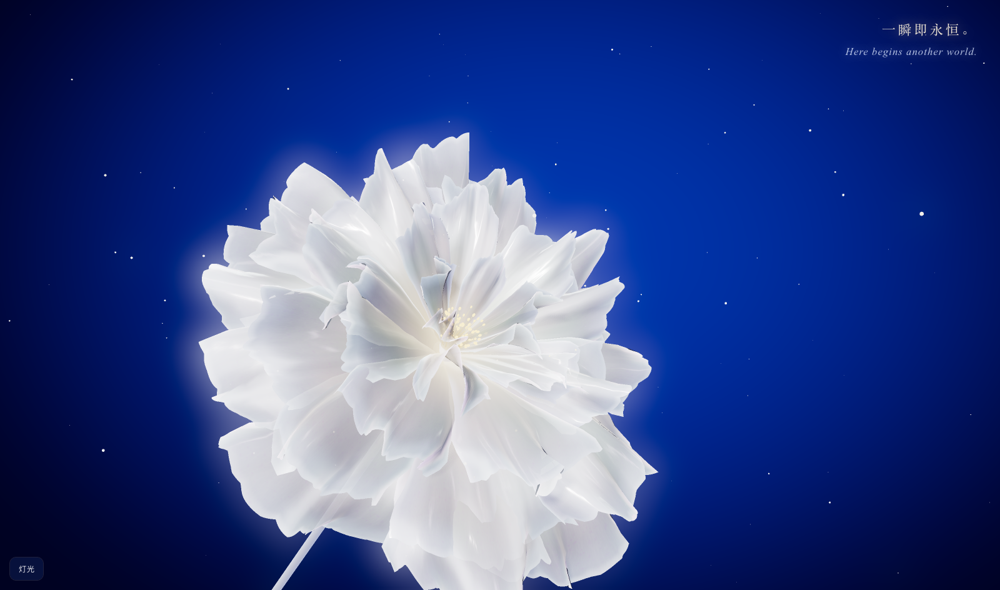

# A Flower, a World · 一花一世界

一朵会随滚动慢慢绽放的白色绸缎之花。

An ethereal white satin flower that opens and closes as you scroll.

<p align="center">
  
</p>

## 体验 · Experience

- 向下滚动（手机上手指上滑），花一层层打开；向上滚动，花慢慢收拢。
- 花完全绽放或完全闭合时，右上角会换一句诗。
- 可以用鼠标拨动花瓣。
- 左下角的「灯光」面板可以切换和调整打光（快捷键 L，Esc 关闭）。

Scroll down (or swipe up) to let the flower bloom, scroll up to let it fade. A new verse appears in the corner each time it is fully open or fully closed. Drag to touch the petals; open the lighting panel at the bottom left to try other looks.

需要支持 WebGPU 的较新浏览器（Chrome / Edge）。Requires a recent browser with WebGPU support.

## 本地运行 · Run locally

```sh
npm install
npm run dev
```

花瓣材质对比页：开发服务器启动后打开 `/petal-lab.html`。

## 基于 · Based on

本作品基于 [Lewis Orton](https://github.com/LewisOrton) 的开源项目 [**Digital Peony**](https://github.com/LewisOrton/digital-peony) 改造而来，沿用了它的 Three.js / WebGPU / TSL 程序化花朵框架、GPU 花瓣物理模拟和后期处理管线。

This work is a modified version of [Digital Peony](https://github.com/LewisOrton/digital-peony) by Lewis Orton, reusing its procedural flower framework, GPU XPBD petal simulation and post-processing pipeline.

在原项目基础上的主要改动：

- 花型：改为 5 层错落的花瓣轮生，每片花瓣姿态、弯曲和外翻程度各不相同，并加上花杆、花托和金色花蕊。
- 材质：银白冷缎面材质，沿花瓣方向的拉丝高光、环境反射与花心暖光。
- 交互：滚动 / 滑动控制开合，外层先开、内层后开。
- 场景：深蓝背景与漂浮光点；原项目的线框开场、故障特效、HUD 与花瓣飞散阶段默认关闭（`src/app/feature-flags.ts`）。
- 文字：绽放 / 收拢诗句与滑动提示。
- 灯光：多套打光方案与实时调整面板。
- 新增独立的花瓣材质对比页 `petal-lab.html`。

## 许可 · License

与原项目相同，以 [Apache License 2.0](./LICENSE) 发布。原项目版权归 Lewis Orton 所有；上面列出的改动由本仓库作者完成。

Released under the [Apache License 2.0](./LICENSE), same as the original. Original work Copyright © 2026 Lewis Orton; modifications as listed above.
